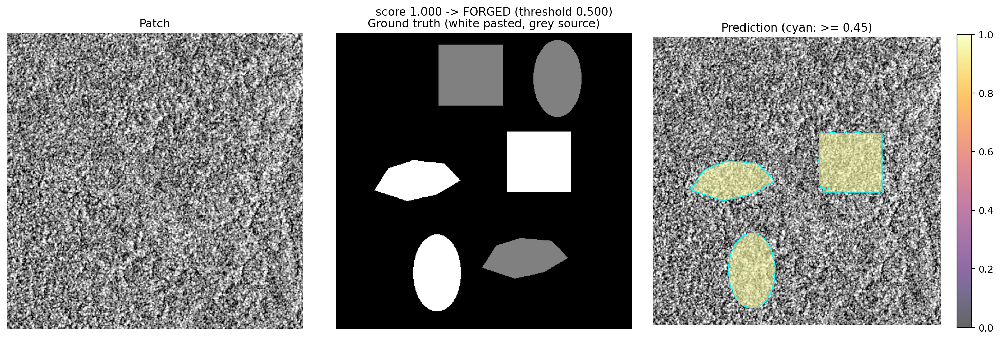
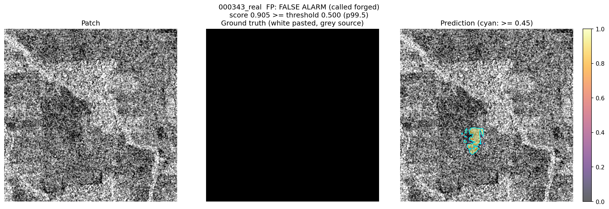
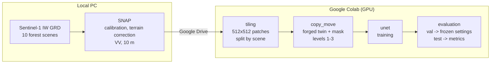
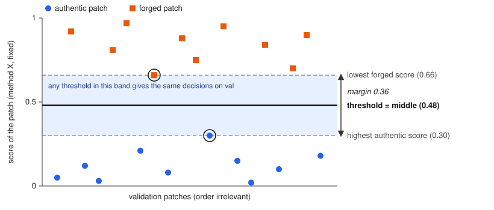

# aletheia

**SAR forensics: detecting tampered and AI-generated Sentinel-1 radar images.**

[](https://github.com/bonlieuguillaume/aletheia/actions/workflows/tests.yml)


Given a SAR image, aletheia answers two questions:
1. **Is it forged?** An image-level score and decision.
2. **Where?** A pixel-level probability map of the tampered regions.



*A test patch never seen in training: three pastes of different shapes
(input | ground truth | predicted map). Level-3 model.*

---

## Why

Fake satellite imagery is no longer a niche concern. During the 2026
US–Iran conflict, AI-generated "satellite" images of supposedly destroyed
bases reached millions of views and were picked up by media outlets before
being debunked. Similar fakes surfaced during the Russia–Ukraine war and the
2025 India–Pakistan clash, while commercial providers restricted or delayed
access to real imagery.

Most fakes so far imitate **optical** imagery. **SAR** (Synthetic Aperture
Radar) is the natural next target: it sees day and night and through clouds,
it is widely used for verification and defence, and its look (speckle,
layover, radar shadows) is counter-intuitive, so a forged SAR image is hard
to challenge by eye.

The guiding scenario: **a military base in a forest hidden by copy-pasted
forest**, the SAR counterpart of the optical case documented by
[Vertical 52](https://vertical52.org/en/lab/fake-forests).

## Status

| Version | Forgery | Question | Status |
|---|---|---|---|
| **v0.1** | copy-move inside the patch | Can a first model detect it? | **done**: detection and localization saturated on levels 1-3 |
| v0.2 | harder copy-move | Does knowledge of SAR physics add value? | next |
| v0.3 | distant-source copy-move, splicing | Does it hold when the pasted region comes from elsewhere? | planned |
| v1 | inpainting, generated images, other sensors | Does it generalize, even against an informed attacker? | planned |

Tasks and priorities: [GitHub Project](https://github.com/users/bonlieuguillaume/projects/5).

## Results of v0.1

**Data.** 10 Sentinel-1 IW GRD scenes over forest (Amazon and Gran Chaco),
VV, 10 m pixels, calibrated and terrain-corrected with SNAP, **no speckle
filter**. Tiled into 2,000 patches of 512x512 px (5 x 5 km), **split by
scene** (6 train / 2 val / 2 test): the test landscapes are never seen in
training. Every authentic patch gets a forged twin with its ground-truth
mask, at three difficulty levels:


| Level | Forgery |
|---|---|
| 1 | one rectangle, 2-5 % of the patch, away from the border |
| 2 | one rectangle, ellipse or irregular polygon, may touch the border |
| 3 | 2 to 4 pastes of mixed shapes, 4-20 % of the patch in all |

**Model.** U-Net with a ResNet-34 encoder (ImageNet weights), one input
channel (VV in dB, one global normalization), reflection padding, BCE + Dice
loss. The image score is read from the map (e.g. its 99.5th percentile);
the score method and both thresholds are chosen on the validation set, then
**frozen** before the single pass on the test set.

**Model x level** (test set, 400 authentic + 400 forged patches per level;
image MCC / mean pixel MCC over forged patches). Each model keeps the
settings chosen on the validation set of its own level:

| Trained on | Level 1 | Level 2 | Level 3 |
|---|---|---|---|
| Level 1 | 1.000 / 0.993 | 0.577 / 0.463 | 0.869 / 0.579 |
| Level 2 | 0.998 / 0.989 | 0.998 / 0.981 | 1.000 / 0.978 |
| **Level 3** (reference) | 0.998 / **0.996** | 0.998 / **0.992** | 0.998 / **0.991** |

What it shows:
- **The level-1 model learned "rectangle", not "duplication"**: it misses
  half the pastes as soon as the shape changes. Its decent level-3 image
  score only comes from patches that happen to contain a rectangle, while
  its localization stays poor: the image score alone can mislead, the map
  tells the truth.
- **The level-3 model is the reference**: one error out of 800 on each
  level, the best localization everywhere, stable with the number of
  pastes and at the patch border. Gaps are small and measured on two test
  scenes: a trend, not a proven ranking.
- **Its single error is a false alarm** on an authentic patch, an
  irregular dark area of forest:



**What comes next.** Copy-move inside the patch is solved, which also means
the benchmark is saturated: there is no room left to measure what SAR
physics cues (speckle statistics, ENL, acquisition geometry) add. v0.2 first
needs harder forgeries: sizes from 1 % to more than 25 % of the patch
([#27](https://github.com/bonlieuguillaume/aletheia/issues/27)), sources far
away in the scene ([#30](https://github.com/bonlieuguillaume/aletheia/issues/30)),
splicing from another acquisition
([#17](https://github.com/bonlieuguillaume/aletheia/issues/17)).

Full analysis, every design choice and its rationale:
[docs/report.md](docs/report.md) (section 5).

### Out-of-domain illustration

The Vertical 52 case itself is an **optical** image. Running the SAR model
on a screenshot of it (grey levels matched to the SAR statistics, see
[features/external_image](features/external_image/)) is shown for
illustration only: optical, resampled and compressed, it has no metric
value.


## How it works



Each step reads its input from Google Drive and writes its output back (one
zip or one run folder), so steps run in separate Colab sessions, and every
run records the git commit and the configuration it came from.

Choices worth knowing (details in
[docs/architecture_v0.1.md](docs/architecture_v0.1.md)):
- **crop, never resize**: resizing would erase the fine traces a detector
  needs;
- **split by scene**, never by patch: otherwise the network recognizes
  landscapes instead of forgeries;
- **the source region of a copy-move is not a false alarm**: masks keep
  pasted (1) and source (2) apart, and the source is ignored by the loss
  and the metrics;
- **segmentation first, decision second**: one map answers both "where" and
  "whether"; no separate classification head;
- **thresholds chosen on val, frozen, test seen once**; the image threshold
  is put in the middle of the interval of equally good thresholds, the
  furthest from both classes:

  

## Quickstart

Everything runs on **Google Colab**; nothing needs to be installed locally.
Data and checkpoints live on Google Drive under `MyDrive/aletheia/`.

| Step | Notebook | Runtime | Reads -> writes |
|---|---|---|---|
| 1. Tiling | [features/tiling/tiling.ipynb](features/tiling/tiling.ipynb) | CPU | scenes -> `patches_v0.1.zip` |
| 2. Forgeries | [features/copy_move/copy_move.ipynb](features/copy_move/copy_move.ipynb) | CPU | patches -> `dataset_v0.1_level<L>.zip` |
| 3. Training | [features/unet/unet.ipynb](features/unet/unet.ipynb) | GPU | dataset -> `runs/<run>/` |
| 4. Evaluation | [features/evaluation/evaluation.ipynb](features/evaluation/evaluation.ipynb) | GPU | run + dataset -> `runs/<run>/eval_level<D>_trained<T>/` |
| Any image | [features/external_image/external_image.ipynb](features/external_image/external_image.ipynb) | GPU | PNG / JPG -> figure + JSON |

Open a notebook in Colab, set the parameters of its first cell, run all.
The scenes are preprocessed beforehand with SNAP (graph:
[docs/snap/GRD_pre_process.xml](docs/snap/GRD_pre_process.xml), scene list:
[docs/v0.1_south_american_forest.csv](docs/v0.1_south_american_forest.csv)).

## Repository layout

```
features/             one feature per folder: module + notebook + README
  sar_io/             file formats: scenes, patches, masks, maps, manifests
  tiling/             scenes -> 512x512 patches, split by scene
  copy_move/          forged twins + masks, difficulty levels
  unet/               model, training (with resume), predict
  evaluation/         settings on val, metrics on test, gallery
  external_image/     any PNG / JPG through a trained model
tests/                pytest on small synthetic SAR-like data
docs/
  report.md           living design report: every choice and why
  architecture_v0.1.md  pipeline, metrics, formulas, trade-offs
  github_actions.md   why the tests run in CI only
```

Tests run on GitHub Actions at every push, on synthetic gamma-speckle
scenes (ENL ~4.4, like Sentinel-1 GRD).

## License

[MIT](LICENSE)
