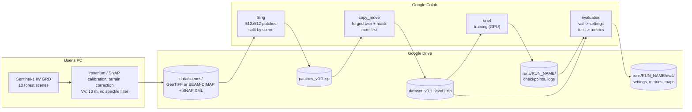
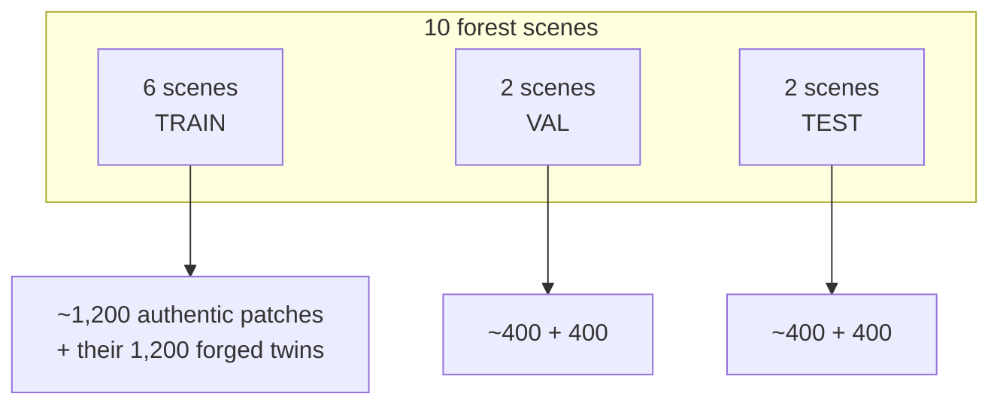
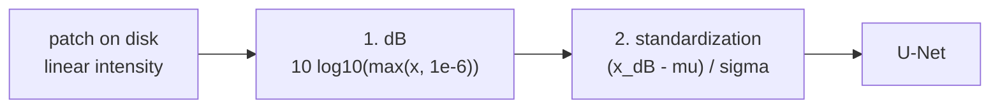
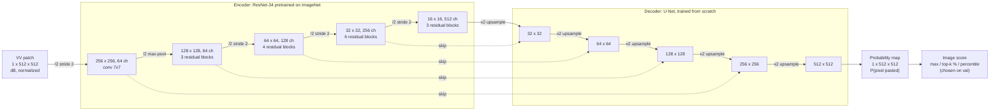
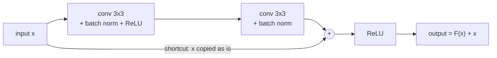
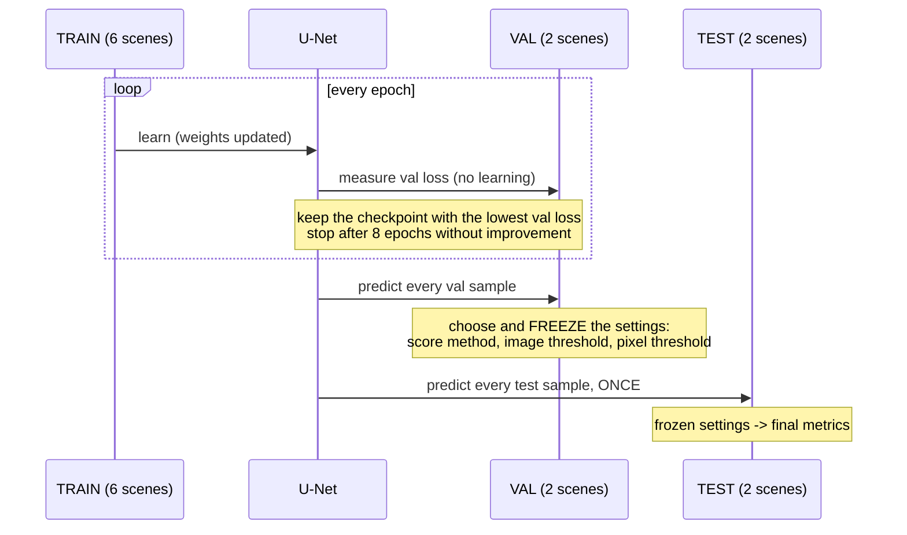
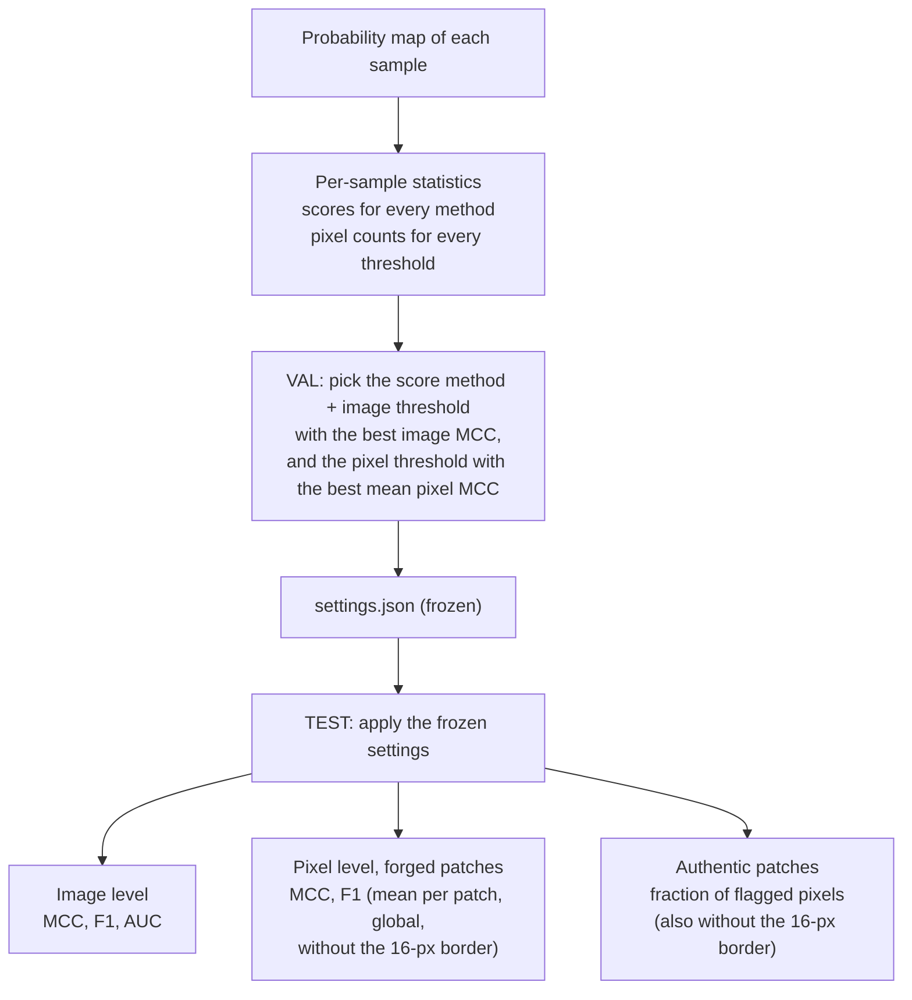

# Architecture of v0.1: copy-move mockup

How v0.1 turns Sentinel-1 scenes into a detector and a measured result: the
data pipeline, the model, the flow between training, validation and test, and
the exact procedure of the metrics. The *why* of each choice is in
[report.md](report.md); the tasks are in the
[GitHub Project](https://github.com/users/bonlieuguillaume/projects/5).

> The diagrams are written in Mermaid: GitHub renders them. In VS Code, the
> built-in Markdown preview needs the "Markdown Preview Mermaid Support"
> extension to show them.

## 1. Overview



Each Colab step reads its input from Drive and writes its output back to
Drive, so a step can run in a new session, days later. Datasets travel as one
zip (Drive is slow with thousands of small files) and are unzipped on the
VM's local disk.

| Step | Notebook | Runtime | Output |
|---|---|---|---|
| Tiling (#28) | `features/tiling/tiling.ipynb` | CPU | 2,000 authentic patches, `patches.csv` |
| Forgeries (#5, #24) | `features/copy_move/copy_move.ipynb` | CPU | 2,000 forged patches, masks, `manifest.csv` |
| Training (#10) | `features/unet/unet.ipynb` | GPU | `best.pt`, `log.csv`, `config.json` |
| Evaluation (#6-#8) | `features/evaluation/evaluation.ipynb` | GPU | `settings.json`, test metrics, maps |

## 2. Data



- **Patch**: 512x512 px (5.12 km at 10 m), cropped, never resized; rejected
  if more than 5 % of its pixels are no-data.
- **Pair**: every authentic patch has one forged twin (level 1: one rectangle
  of 2-5 % of the patch, copied from elsewhere in the same patch, both regions
  at least 32 px from the border). A pair always stays in one split.
- **Mask**: `0` background, `1` pasted (the forgery), `2` source.
- **Split by scene**: no landscape of the test was seen in training.
- **Orbits balanced**: ideally 5 ascending + 5 descending scenes; otherwise
  some scenes of the majority orbit are mirrored east-west, which gives them
  exactly the look direction of the other orbit. Val and test each get one
  scene of each geometry.
- **Augmentation** (optional, compared in #37): the same east-west mirror,
  applied at random to half of the training patches.

### Input of the network: dB conversion, then normalization

The files stay in **linear** values on disk (recommended SNAP export:
calibrated intensity, float32, linear). Every patch then goes through two
steps, in memory, always in the same order, in training and in prediction
(`unet.to_model_scale`, then the normalization in `SARPatchDataset.load` and
`unet.predict_probabilities`). No raw pixel ever enters the network.



**1. Why dB.**

- *Dynamic range.* In linear intensity one scene spans about 5 orders of
  magnitude: calm water ~0.001 (-30 dB), forest ~0.1 (-10 dB), bright
  reflectors (buildings, pylons) 10 to 100 (+10 to +20 dB). Most pixels are
  squeezed near 0 and a few bright ones dominate (long-tailed distribution),
  which makes learning unstable. The logarithm compresses the range into a
  roughly bell-shaped distribution.
- *Speckle becomes additive.* Speckle is multiplicative: the measured
  intensity is the true reflectivity times a random factor, $I = R \cdot n$,
  so bright pixels are much noisier in absolute terms than dark ones. The log
  turns the product into a sum, $10 \log_{10} I = 10 \log_{10} R + 10 \log_{10} n$:
  the noise has the same amplitude everywhere, which suits convolutions (the
  same filter is applied over the whole image).
- Zeros (no-data, very dark pixels) are clamped to $10^{-6}$ before the log,
  so they give a finite value (-60 dB) instead of $-\infty$.

**2. Why a global standardization.** $\tilde{x} = (x_{dB} - \mu) / \sigma$,
with $\mu$ and $\sigma$ computed **once**, on authentic training patches only,
and saved in the `config.json` of the run; the same values are applied to
every patch of every split. The network then sees values centred on 0 with a
standard deviation of 1, the scale the ImageNet-pretrained encoder was trained
on.

- *Global, not per patch:* a per-patch standardization would erase the
  radiometric differences between regions, which splicing detection (v0.3)
  relies on.
- *It absorbs constant factors.* Intensity is the square of amplitude, so
  giving amplitude instead of intensity halves every dB value
  ($10 \log_{10} A = \tfrac{1}{2} \cdot 10 \log_{10} I$); but $\mu$ and $\sigma$
  are halved too, and $(0.5 x - 0.5 \mu) / (0.5 \sigma) = (x - \mu) / \sigma$:
  the network receives exactly the same values. Likewise, a calibration
  constant (a factor in linear, an offset in dB) is removed by subtracting
  $\mu$. Condition: **all scenes processed the same way** (all intensity or
  all amplitude, same calibration); a global normalization absorbs a factor
  common to the dataset, not a mixture.

**If the scenes are exported in dB anyway**, the conversion must be the very
last step of the SNAP graph, after terrain correction (which interpolates
between pixels, and an average taken in dB is wrong), and the U-Net notebook
must be set to `"input_scale": "db"` so the code skips step 1. Linear export is
preferred: the speckle statistics of v0.2 (coefficient of variation, ENL,
Gamma fit) are defined on linear intensity.

**Not to be confused with batch normalization**, the layers *inside* the
network that re-normalize the activations between layers: they are part of
the architecture and are learned with it, whereas this standardization is a
fixed preprocessing of the input data.

## 3. Model



The dashed arrows are the **U-Net skip connections** (long, encoder to
decoder, concatenation). The **ResNet residual shortcuts** are inside each
encoder box: every box is a stage of 3 to 6 residual blocks, each with its own
shortcut (16 blocks in all; 16 x 2 convolutions + the first convolution + the
classification layer removed by the U-Net = the 34 layers of ResNet-34).
One residual block:



If a block has nothing useful to add, it only has to learn F(x) = 0 and the
signal goes through the shortcut unchanged: this is what lets very deep
networks train.

**How the size changes** (all inside `smp.Unet`):

- *Encoder, /2 five times:* 512 -> 256 by the first 7x7 convolution with a
  stride of 2 (the filter moves 2 pixels at a time, so one output value per
  2 pixels); 256 -> 128 by a 2x2 max-pooling; 128 -> 64 -> 32 -> 16 by the
  **first block** of stages 2, 3 and 4, whose first convolution has a stride
  of 2. In those blocks F(x) is smaller than x, so their shortcut goes through
  a 1x1 convolution with a stride of 2 that brings x to the same size and
  number of channels before the addition. All other blocks keep the size.
- *Decoder, x2 five times:* each decoder block (1) upsamples by 2 (each pixel
  copied into a 2x2 square, nearest-neighbour), (2) concatenates the skip
  connection of the same size, (3) applies two 3x3 convolutions that keep the
  size and refine the coarse upsampling with the details of the skip. The
  last step, 256 -> 512, has no skip (no 512 stage in the encoder); a final
  3x3 convolution reduces the channels to 1, the probability map.

- **Encoder**: a ResNet-34 (residual blocks, short additive shortcuts) whose
  ImageNet weights give it ready-made edge and texture filters; its first
  layer is adapted to one channel.
- **Decoder**: upsamples back to 512x512; the **skip connections** bring the
  fine details of the encoder back, so the map follows the paste's edges.
- **Reflection padding** in every convolution (#31): no artificial edge of
  zeros at the patch border.
- **Loss**: BCE + Dice computed over the batch, on `mask == 1`, source pixels
  ignored.
- **Optimization**: AdamW, learning rate 3e-4 decayed along a cosine over the
  planned epochs, weight decay 1e-4, batches of 8, mixed precision (why:
  [report.md](report.md), section 4).

## 4. Training, validation, test



**Train to learn, val to tune and choose, test to grade.** The test set is
used once, at the end; changing anything after seeing the test results would
make it a second validation set and its score optimistic.

## 5. Metrics: the exact procedure



Step by step:

1. **Prediction.** For every sample, the model outputs a probability map:
   512x512 values in [0, 1], the probability that each pixel was pasted.
2. **Per-sample statistics** (`sample_statistics`). Thresholds are not known
   yet, so everything is stored for every candidate:
   - the image score with each method: `max` (highest pixel), `top0.5%`,
     `top1%`, `top2%` (mean of the highest pixels, robust to one noisy pixel;
     k must stay below the smallest paste) and `p99.5` (percentile);
   - for a forged patch, the pixel counts TP / FP / FN / TN for each pixel
     threshold 0.05, 0.10, ..., 0.95, comparing `map >= threshold` with
     `mask == 1`, **source pixels excluded** (neither hit nor false alarm),
     on the full patch and without a 16-px border (#32);
   - for an authentic patch, the fraction of pixels above each threshold
     (false alarms).
3. **Settings, on the validation set** (`choose_thresholds`):
   - image level: for each score method, every distinct score value is tried
     as a threshold ("forged" if score >= threshold). Neighbouring thresholds
     often reach the same best **image MCC**: they form an interval of equally
     good thresholds, and its **middle** is kept, not its edge, so that a
     small shift of the scores on new images changes fewer decisions; the
     width of that interval is the **margin**. The method with the best image
     MCC is kept; between methods with the same MCC, the one with the widest
     margin (the most robust), not the first of the list.
     - *The bounds of the interval* are the two patches closest to the
       boundary: the highest score that must stay below the threshold and
       the lowest score that must be above it. No val patch scores in
       between, so every threshold in between gives the same decisions.
       Patches that are on the wrong side whatever the threshold (the errors
       left at the best MCC) are not bounds: they cannot be recovered.
     - *Example:* the patch that must stay below scores 0.30, the one that
       must be above scores 0.97. The former rule took 0.97, touching the
       patch above; the middle, 0.635, keeps 0.335 on each side. On the
       first v0.1 run (top0.5% score), the interval was (0.081, 0.997]: the
       former rule sat at 0.997 although a margin of 0.916 was available.
     - Same idea as the maximum-margin boundary of support vector machines
       (SVM): among the boundaries that separate equally well, take the one
       furthest from the closest points;
   - pixel level: the threshold giving the best **mean per-patch pixel MCC**
     over the forged patches is kept;
   - *Why the scores themselves rather than a grid, for the image threshold:*
     decisions only change when the threshold crosses the score of a patch;
     between two neighbouring scores every threshold gives exactly the same
     decisions. Trying each score therefore tries every possible set of
     decisions (at most ~800 cheap tries) and cannot miss the best one. A
     grid can: with saturated scores (authentic up to 0.9968, forged from
     0.9978), a 0.01 step only tries 0.99 (one false alarm) and 1.00 (one
     miss), and no step is fine enough for sure. The rounder threshold a grid
     would give is recovered by taking the middle of the optimal interval.
   - *Why a grid for the pixel threshold:* the candidates would be every
     pixel value, 400 patches x 262,144 pixels, and the mean per-patch pixel
     MCC changes slowly with the threshold: a 0.05 step is close enough.
   - the three settings are written to `eval/settings.json` and frozen.
4. **Final metrics, on the test set** (`compute_metrics`), with the frozen
   settings:
   - **image level**: one decision per patch, then the confusion matrix over
     the ~800 test patches, **MCC** and **F1**; **ROC AUC** from the raw
     scores (threshold-free);
   - **pixel level**, forged patches only: MCC and F1 of each patch, then
     **averaged** (each paste counts the same) and **global** (all pixels
     pooled, each pixel counts the same); the mean MCC is also given without
     the border band;
   - **authentic patches**: mean fraction of pixels flagged by mistake
     (ideally 0), also given without the border band. For each authentic
     patch, the map is thresholded with the frozen pixel threshold, and
     `false_alarm` = flagged pixels / all pixels of the patch. MCC and F1 do
     not apply there (an authentic patch has no forged pixel, so every flagged
     pixel is a false positive and there is nothing to find). This is a
     pixel-level notion, distinct from the image-level false positive: a
     patch can have a few flagged pixels and still be declared authentic if
     its image score stays below the image threshold.
5. **Breakdown.** The per-sample table is joined with the manifest, so the
   results can be sliced by level, paste size or scene.

### Why the source pixels are ignored

**The problem.** A copy-move copies a region A (the **source**, `mask == 2`)
and pastes it at B (the **target**, `mask == 1`). B becomes an exact copy of
A, pixel for pixel:

```
  forged patch
  +--------------------+
  |   +--+             |
  |   |A |             |   A = the original (genuine)
  |   +--+             |
  |           +--+     |
  |           |B |     |   B = the copy (the forgery)
  |           +--+     |
  +--------------------+
```

From the image, one sees two identical regions, but almost nothing says which
one is the original: the only clue is subtle (B has artificial seams with its
new surroundings, A does not). A detector will therefore often find "there is
a duplicate here" and light up **both A and B**, although the right answer is
B only. What should be done with A?

**The three options.**

| Option | Consequence |
|---|---|
| Count A as a **false alarm** | Punishes the model for something almost impossible to avoid, and punishes duplicate-finding methods (block correlation, Vertical 52 keypoint matching), which by construction always find both twins. |
| Count A as a **hit** | Rewards lighting up a region that is genuine: wrong. |
| **Ignore A** (chosen) | A's pixels count neither as an error nor as a success, in the **loss** and in the **pixel metrics**. The model is judged on two questions only: does it find B, and does it light up the rest of the patch by mistake? |

**The trade-off of ignoring A.**

- *Gained:* simpler learning (the model can rely fully on the cue "these two
  regions are identical" to find B, without being held back by having to
  guess which twin is the copy) and a fair comparison (U-Net, block
  correlation and Vertical 52 are scored the same way, although the last two
  always light up A and B).
- *Accepted:* the model is never punished for lighting up A, so in practice
  its map will often show two regions: B, the real forgery, and A, genuine
  pixels lit up by mistake. That false positive is **not counted** by our
  metrics. And since A and B have the same size, **the larger the paste, the
  larger that genuine area lit up by mistake**.
- *Why the cost is acceptable:* for an analyst, two twin regions lit up lead
  straight to the right conclusion, "this region was duplicated"; which twin
  is the copy is then usually clear from the context (a forest covering a
  base). This is how Vertical 52 presents its own results.

Telling A from B is planned for later (#38): nothing has to be regenerated,
the mask already separates them (`1` for B, `2` for A); only the counting
rule changes (see `v_i` in section 6).

### What "without a 16-px border" measures (#32)

A diagnostic only: two figures are computed again on the central 480x480
square, ignoring a 16-px band along the edges, where the network sees less
context. Everything else (loss, thresholds, image metrics...) uses the full
patch.

- `pixel_mcc_mean_margin`: mean pixel MCC over the forged patches;
- `false_alarm_mean_margin`: mean fraction of flagged pixels over the
  authentic patches.

How to read it: the band covers 12 % of the patch. Equal values with and
without the band: no border effect. Clearly better values without it: errors
concentrate near the edges (e.g. 0.11 % of flagged pixels on the full patch
but 0.04 % without the band means two thirds of the false alarms sit in the
band). At level 1 pastes stay 32 px away from the border, so the gap only
reflects border false alarms (a check of reflection padding, #31); from
level 2 on, it also shows whether pastes touching the border are missed.

Worked example, image level, 400 forged + 400 authentic test patches:

| | flagged | not flagged |
|---|---|---|
| forged (400) | TP = 370 | FN = 30 |
| authentic (400) | FP = 20 | TN = 380 |

F1 = 2·370 / (2·370 + 20 + 30) = **0.94**;
MCC = (370·380 − 20·30) / √(390·400·400·410) = **0.88**.

Pixel level, why not accuracy: a level-1 paste covers ~3 % of the pixels. A
model that flags nothing is 97 % accurate, but its F1 and MCC are 0.

| Model | Accuracy | F1 | MCC |
|---|---|---|---|
| flags nothing | 97 % | 0 | 0 |
| 7,000 / 7,900 pasted pixels found, 600 false alarms | 99.4 % | 0.90 | 0.90 |

## 6. Key formulas

Notation: a patch has $N \times N$ pixels ($N = 512$), indexed by $i$; $x_i$
is the raw SAR value, $m_i \in \{0, 1, 2\}$ the mask, $z_i$ the network output
(logit) and $p_i = \sigma(z_i) = 1 / (1 + e^{-z_i})$ the probability that the
pixel was pasted.

**Input** (`unet.to_model_scale`, `compute_normalization`): conversion to dB,
then one global standardization, with $\mu, \sigma$ computed on authentic
training patches only:

$$x^{dB}_i = 10 \log_{10}\big(\max(x_i, 10^{-6})\big), \qquad \tilde{x}_i = \frac{x^{dB}_i - \mu}{\sigma}$$

**Level-1 paste size** (`copy_move.random_rectangle_size`): area fraction
$a \sim \mathcal{U}[0.02, 0.05]$, aspect ratio $r = h / w \sim \mathcal{U}[0.5, 2]$:

$$h = \mathrm{round}\big(\sqrt{a N^2 r}\big), \qquad w = \mathrm{round}\big(\sqrt{a N^2 / r}\big)$$

**East-west mirror** (`tiling.mirror_east_west`): a look direction $d$
(degrees from north) becomes $360° - d$; ascending $78° \mapsto 282°$ =
descending.

**Target and valid pixels**: the forgery to find, and the pixels that count
(the source is excluded, see section 5):

$$t_i = \mathbb{1}[m_i = 1], \qquad v_i = \mathbb{1}[m_i \neq 2]$$

For an authentic patch, $t_i = 0$ and $v_i = 1$ everywhere.

**Loss** (`unet.loss_function`), sums over all pixels of all patches of the
batch:

$$\mathrm{BCE} = \frac{\sum_i v_i \cdot \ell_i}{\sum_i v_i}, \qquad \ell_i = -\big[t_i \log p_i + (1 - t_i) \log(1 - p_i)\big]$$

$$\mathrm{Dice}_{batch} = \frac{2 \sum_i v_i \cdot p_i \cdot t_i}{\sum_i v_i \cdot p_i + \sum_i v_i \cdot t_i + \varepsilon}, \qquad \mathcal{L} = \mathrm{BCE} + (1 - \mathrm{Dice}_{batch})$$

Multiplying by $v_i$ removes the source pixels from every sum: this is how the
source is ignored. Worked example: 4 pixels, one background ($t = 0$), one
pasted ($t = 1$), two source ($v = 0$); the per-pixel BCE terms are
$\ell = (0.1, 0.2, 2.0, 2.0)$, the last two high because the model lights up
the source. Without $v$: $\mathrm{BCE} = (0.1 + 0.2 + 2.0 + 2.0) / 4 = 1.08$,
the source is punished. With $v = (1, 1, 0, 0)$:
$\mathrm{BCE} = (0.1 + 0.2 + 0 + 0) / 2 = 0.15$, as if the source pixels did
not exist (the denominator, $\sum_i v_i$, counts only the valid pixels). $\varepsilon = 10^{-6}$ only guards against a division by
zero. It is **not** the smoothing constant $s$ of a per-patch Dice,
$(2I + s) / (P + T + s)$: that one solves a different problem (an authentic
patch has an empty mask, so its own Dice would be $0/0$), which the batch Dice
avoids since every batch holds forged patches. Per-patch Dice with $s$ is only
the fallback for level 4 (#27).

**Image score** (`evaluation.image_score`), from the map of one patch:

$$S_{max} = \max_i p_i, \qquad S_{top\text{-}k} = \text{mean of the } \lceil k N^2 \rceil \text{ largest } p_i, \qquad S_{p99.5} = \text{99.5th percentile of the } p_i$$

**Confusion counts** at a pixel threshold $\tau$ (`evaluation.confusion_counts`),
with $\hat{y}_i = \mathbb{1}[p_i \geq \tau]$:

$$TP = \sum_i v_i \hat{y}_i t_i, \quad FP = \sum_i v_i \hat{y}_i (1 - t_i), \quad FN = \sum_i v_i (1 - \hat{y}_i) t_i, \quad TN = \sum_i v_i (1 - \hat{y}_i)(1 - t_i)$$

At image level, the same counts are taken over patches, with
$\hat{y} = \mathbb{1}[S \geq \tau_{img}]$ and the label of each patch.

**MCC and F1** (`evaluation.mcc`, `evaluation.f1`):

$$\mathrm{MCC} = \frac{TP \cdot TN - FP \cdot FN}{\sqrt{(TP+FP)(TP+FN)(TN+FP)(TN+FN)}}, \qquad F_1 = \frac{2 \cdot TP}{2 \cdot TP + FP + FN}$$

MCC is set to 0 when its denominator is 0. $F_1$ at pixel level is the Dice
coefficient.

**Mean per patch vs global** (pixel level, over the $K$ forged patches):

$$\mathrm{MCC}_{mean} = \frac{1}{K} \sum_{k=1}^{K} \mathrm{MCC}(\text{counts}_k), \qquad \mathrm{MCC}_{global} = \mathrm{MCC}\Big(\sum_{k=1}^{K} \text{counts}_k\Big)$$

In the mean, each paste counts the same; in the global value, each pixel does
(large pastes weigh more). So in the mean, a missed 2 % paste lowers the
score as much as a missed 5 % one, while in the global value a model that
finds the large pastes and misses the small ones can still score well. The
**mean is the main pixel metric** (it is also the one the pixel threshold is
chosen on): we want every forgery located, whatever its size. Two close
values (0.9926 and 0.9929 on the v0.1 test) mean the localization does not
depend on the paste size.

**False alarms** on an authentic patch, over a pixel set $\Omega$ (the whole
patch, $|\Omega| = 262{,}144$, or the central square without the 16-px band,
$|\Omega| = 230{,}400$):

$$FA = \frac{1}{|\Omega|} \sum_{i \in \Omega} \mathbb{1}[p_i \geq \tau_{pix}]$$

**Settings chosen on the validation set** (`evaluation.choose_thresholds`):

$$(\text{method}^{\star}, \tau_{img}^{\star}) = \arg\max_{\text{method}, \tau} \mathrm{MCC}^{val}_{img}, \qquad \tau_{pix}^{\star} = \arg\max_{\tau \in \{0.05, 0.10, \dots, 0.95\}} \mathrm{MCC}^{val}_{mean}(\tau)$$

with $\tau_{img}^{\star}$ taken in the middle of the interval of thresholds that
reach the best MCC, and ties between methods broken by the width of that
interval (the margin).

**ROC AUC** (image level, threshold-free): the probability that a randomly
chosen forged patch gets a higher score than a randomly chosen authentic one
(0.5 = chance, 1 = perfect ranking).

## 7. Reproducibility

- Every random draw is seeded: scene split, patch draw (per scene),
  forgeries (per patch), training.
- `config.json` of a run records its configuration, the normalization
  statistics and the git commit of the code.
- `manifest.csv` records, for every sample, its scene, position, split and
  forgery parameters.
- The tests run on GitHub Actions at every push ([github_actions.md](github_actions.md)).
