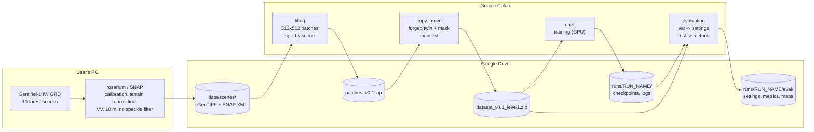
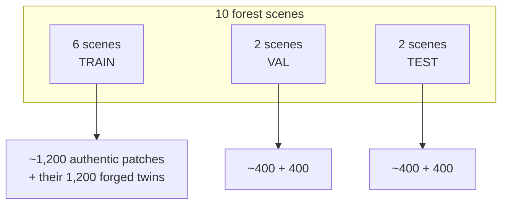
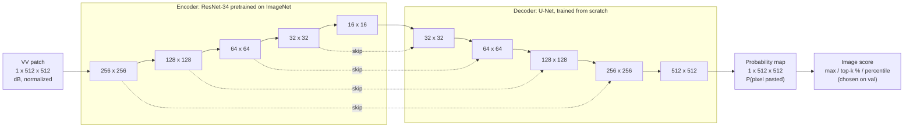
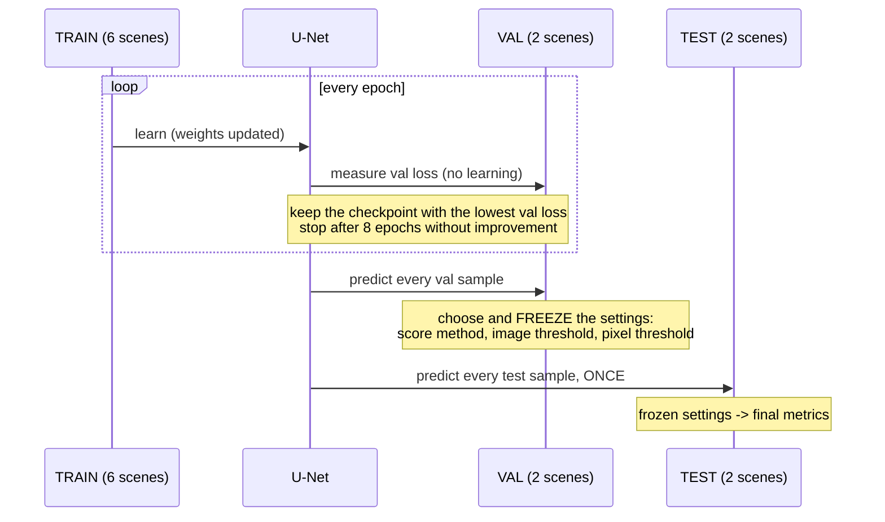
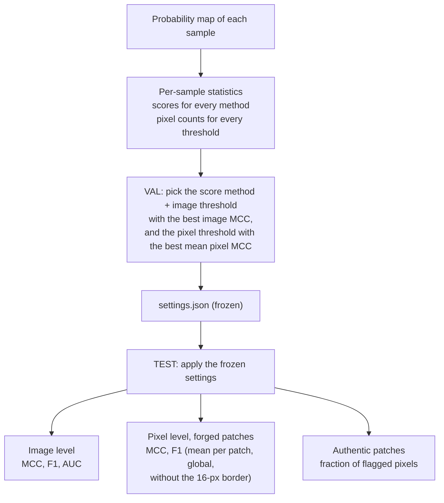

# Architecture of v0.1: copy-move mockup

How v0.1 turns Sentinel-1 scenes into a detector and a measured result: the
data pipeline, the model, the flow between training, validation and test, and
the exact procedure of the metrics. The *why* of each choice is in
[report.md](report.md); the tasks are in the
[GitHub Project](https://github.com/users/bonlieuguillaume/projects/5).

> The diagrams are written in Mermaid: GitHub renders them. In VS Code, the
> built-in Markdown preview needs the "Markdown Preview Mermaid Support"
> extension to show them.

## 1. Overview

Each Colab step reads its input from Drive and writes its output back to
Drive, so a step can run in a new session, days later. Datasets travel as one
zip (Drive is slow with thousands of small files) and are unzipped on the
VM's local disk.

| Step | Notebook | Runtime | Output |
|---|---|---|---|
| Tiling (#28) | `features/tiling/tiling.ipynb` | CPU | 2,000 authentic patches, `patches.csv` |
| Forgeries (#5, #24) | `features/copy_move/copy_move.ipynb` | CPU | 2,000 forged patches, masks, `manifest.csv` |
| Training (#10) | `features/unet/unet.ipynb` | GPU | `best.pt`, `log.csv`, `config.json` |
| Evaluation (#6-#8) | `features/evaluation/evaluation.ipynb` | GPU | `settings.json`, test metrics, maps |

## 2. Data

- **Patch**: 512x512 px (5.12 km at 10 m), cropped, never resized; rejected
  if more than 5 % of its pixels are no-data.
- **Pair**: every authentic patch has one forged twin (level 1: one rectangle
  of 2-5 % of the patch, copied from elsewhere in the same patch, both regions
  at least 32 px from the border). A pair always stays in one split.
- **Mask**: `0` background, `1` pasted (the forgery), `2` source.
- **Split by scene**: no landscape of the test was seen in training.
- **Orbits balanced**: ideally 5 ascending + 5 descending scenes; otherwise
  some scenes of the majority orbit are mirrored east-west, which gives them
  exactly the look direction of the other orbit. Val and test each get one
  scene of each geometry.
- **Augmentation** (optional, compared in #37): the same east-west mirror,
  applied at random to half of the training patches.

## 3. Model

- **Encoder**: a ResNet-34 (residual blocks, short additive shortcuts) whose
  ImageNet weights give it ready-made edge and texture filters; its first
  layer is adapted to one channel.
- **Decoder**: upsamples back to 512x512; the **skip connections** bring the
  fine details of the encoder back, so the map follows the paste's edges.
- **Reflection padding** in every convolution (#31): no artificial edge of
  zeros at the patch border.
- **Loss**: BCE + Dice computed over the batch, on `mask == 1`, source pixels
  ignored.

## 4. Training, validation, test

**Train to learn, val to tune and choose, test to grade.** The test set is
used once, at the end; changing anything after seeing the test results would
make it a second validation set and its score optimistic.

## 5. Metrics: the exact procedure

Step by step:

1. **Prediction.** For every sample, the model outputs a probability map:
   512x512 values in [0, 1], the probability that each pixel was pasted.
2. **Per-sample statistics** (`sample_statistics`). Thresholds are not known
   yet, so everything is stored for every candidate:
   - the image score with each method: `max` (highest pixel), `top0.5%`,
     `top1%`, `top2%` (mean of the highest pixels, robust to one noisy pixel;
     k must stay below the smallest paste) and `p99.5` (percentile);
   - for a forged patch, the pixel counts TP / FP / FN / TN for each pixel
     threshold 0.05, 0.10, ..., 0.95, comparing `map >= threshold` with
     `mask == 1`, **source pixels excluded** (neither hit nor false alarm),
     on the full patch and without a 16-px border (#32);
   - for an authentic patch, the fraction of pixels above each threshold
     (false alarms).
3. **Settings, on the validation set** (`choose_thresholds`):
   - image level: for each score method, every distinct score value is tried
     as a threshold ("forged" if score >= threshold); the method and threshold
     giving the best **image MCC** are kept;
   - pixel level: the threshold giving the best **mean per-patch pixel MCC**
     over the forged patches is kept;
   - the three settings are written to `eval/settings.json` and frozen.
4. **Final metrics, on the test set** (`compute_metrics`), with the frozen
   settings:
   - **image level**: one decision per patch, then the confusion matrix over
     the ~800 test patches, **MCC** and **F1**; **ROC AUC** from the raw
     scores (threshold-free);
   - **pixel level**, forged patches only: MCC and F1 of each patch, then
     **averaged** (each paste counts the same) and **global** (all pixels
     pooled, each pixel counts the same); the mean MCC is also given without
     the border band;
   - **authentic patches**: mean fraction of pixels flagged by mistake
     (ideally 0).
5. **Breakdown.** The per-sample table is joined with the manifest, so the
   results can be sliced by level, paste size or scene.

Worked example, image level, 400 forged + 400 authentic test patches:

| | flagged | not flagged |
|---|---|---|
| forged (400) | TP = 370 | FN = 30 |
| authentic (400) | FP = 20 | TN = 380 |

F1 = 2·370 / (2·370 + 20 + 30) = **0.94**;
MCC = (370·380 − 20·30) / √(390·400·400·410) = **0.88**.

Pixel level, why not accuracy: a level-1 paste covers ~3 % of the pixels. A
model that flags nothing is 97 % accurate, but its F1 and MCC are 0.

| Model | Accuracy | F1 | MCC |
|---|---|---|---|
| flags nothing | 97 % | 0 | 0 |
| 7,000 / 7,900 pasted pixels found, 600 false alarms | 99.4 % | 0.90 | 0.90 |

## 6. Reproducibility

- Every random draw is seeded: scene split, patch draw (per scene),
  forgeries (per patch), training.
- `config.json` of a run records its configuration, the normalization
  statistics and the git commit of the code.
- `manifest.csv` records, for every sample, its scene, position, split and
  forgery parameters.
- The tests run on GitHub Actions at every push ([github_actions.md](github_actions.md)).
